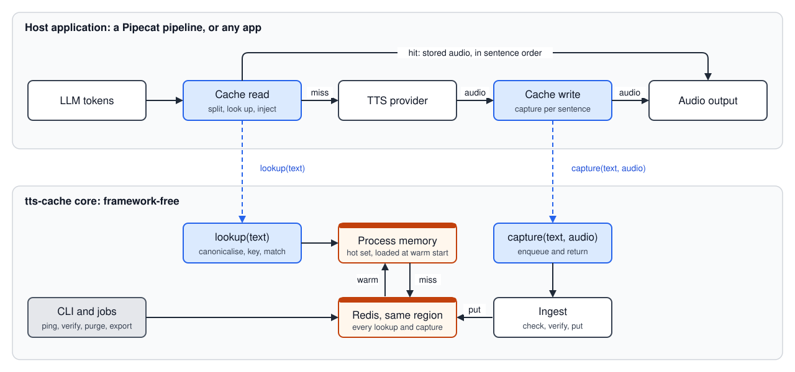

# Smart TTS Caching for Voice Agents

**A sentence-level audio cache for Pipecat voice agents.** When an agent is about to say a sentence it has already said in the same voice, the cache plays the stored audio instead of calling the TTS provider: the sentence is not billed, and it starts playing in milliseconds.


## Try the demo

Run a live call with the cache on your own machine. You need macOS or Linux, a microphone, a [Sarvam API key](https://dashboard.sarvam.ai) and an [OpenAI API key](https://platform.openai.com/api-keys).

```bash
git clone https://github.com/adimyth/smart-tts-caching.git
cd smart-tts-caching
./demo/quickstart.sh
```

1. The script installs what it needs, starts Redis and the agent locally, and asks for the two keys the first time, saving them to `.env`. The first run also downloads about 1.6 GB of models; `--no-level-c` skips them.
2. The call page opens at http://127.0.0.1:7860. Press **Connect** and talk to Ananya, the appointment desk of a fictional hospital, who speaks Hinglish.
3. Hang up, press **Connect** again and say the same things. Every sentence Ananya repeats now plays from the cache: it shows a HIT badge and starts in a few milliseconds.

`--lang en` makes Ananya speak English, `--prompt my_prompt.txt` runs your own system prompt, and `--mode scripted` replays the two calls of the launch video with a Sarvam key alone. More options are in [demo/README.md](demo/README.md).

To watch instead, the launch video is in [English](smart-tts-caching-en.mp4) and [Hinglish](smart-tts-caching-hi.mp4).

- [Smart TTS Caching for Voice Agents](#smart-tts-caching-for-voice-agents)
  - [Try the demo](#try-the-demo)
  - [Why](#why)
  - [Features](#features)
  - [How it works](#how-it-works)
    - [Match levels](#match-levels)
  - [Results](#results)
    - [Correctness](#correctness)
    - [Hit rate](#hit-rate)
    - [Latency](#latency)
    - [Cost](#cost)
  - [Installation](#installation)
  - [Quick start](#quick-start)
    - [1. Estimate the hit rate](#1-estimate-the-hit-rate)
    - [2. Wire it into Pipecat](#2-wire-it-into-pipecat)
    - [3. Check it](#3-check-it)
    - [Supported services](#supported-services)
  - [Configuration](#configuration)
    - [Stores](#stores)
    - [Policies](#policies)
    - [Level C (experimental)](#level-c-experimental)
  - [Operations](#operations)
  - [Guarantees and limitations](#guarantees-and-limitations)
    - [Guarantees](#guarantees)
    - [Known limitations](#known-limitations)
  - [License](#license)
  - [Design](#design)
  - [Contributing](#contributing)

## Why

A voice agent sends every sentence it speaks to a TTS provider. Each request is billed per character, and the caller waits 130 ms to 2.4 s for the first audio. Agents repeat themselves: greetings, confirmations, disclosures and closings recur in the same voice for every caller, and each repeat is synthesised and billed again. The repeats happen across sessions rather than within one, so the cache is shared by every session of a deployment.

## Features

- **Drop-in for Pipecat.** Two frame processors placed around a stock TTS service; the service, the LLM and the transport are unchanged.
- **Exact and near-duplicate matching**, on by default. A sentence that differs only in punctuation or a leading filler ("Okay, …") reuses the stored clip. A changed name, number, date, amount, negation or question mark never does.
- **Voice-safe keys.** Provider, model, voice, language, sample rate and audio settings are part of every key, so changing any of them never replays old audio.
- **Fails open.** Every store call has a 20 ms deadline. A slow, failing or unreachable store turns the sentence into an ordinary provider request, and no cache error reaches the pipeline.
- **Shared and fast.** Redis is shared by all sessions, and each process keeps its most-used clips in memory, loaded at start, so a fresh container hits from its first sentence.
- **Multilingual.** Canonicalisation and near-duplicate matching cover English and eleven Indian languages: Hindi, Bengali, Assamese, Punjabi, Gujarati, Marathi, Odia, Tamil, Telugu, Kannada and Malayalam. Exact matching works in any language.
- **Policies.** Rules for which sentences are stored, how long a clip lives, and which near-duplicates may play. You can skip personal data, keep each tenant's audio separate, or cache only the opening and closing sentence of a turn.
- **Operable.** Estimate the hit rate from your own transcripts before deploying, warm a new deployment, check Redis placement, purge by tag or text, and export metrics as JSON lines or Pipecat `MetricsFrame`s.

## How it works



1. The LLM's output is split into sentences, the unit a provider synthesises in one request.
2. Each sentence is keyed on its canonical text, taken after Pipecat's own text filters and transforms, plus the scope: the provider, TTS model, voice, language, sample rate and audio settings. Both have to match before a stored clip can play.
3. The key is looked up in the shared store. On a hit, the stored audio plays in the sentence's place and the provider is skipped. On a miss, the provider synthesises as usual, and the clip is captured, checked and stored for next time.

Before the lookup, the sentence is rewritten to one spelling. Case, extra spaces and markdown are folded in, and so are characters a provider speaks the same way: the digits १२३ and 123, or the Hindi stop । and a full stop.

### Match levels

Each level runs only when the previous one misses.

A **slot** is a fact inside the sentence: a name, a number, a date, an amount, or a product. In "Your refund of ₹2,349 will reach you by Thursday" the amount and the day are slots. A stored clip never plays when a slot differs, because the caller would hear the wrong fact.

| Level | Serves | Status | How it decides |
|---|---|---|---|
| **A**, exact | The same canonical text | On by default | Hash lookup |
| **B**, near duplicate | The same words, differing only in punctuation or leading and trailing filler | On by default | MinHash candidates, an edit-distance check and a diff classifier. A changed slot, a negation, or a question mark is never served |
| **C**, paraphrase | The same meaning in different words | Experimental, off | A multilingual encoder (`multilingual-e5-small`) proposes the nearest stored sentence. The slot veto compares the facts and refuses the candidate when they differ. The span veto refuses a candidate whose only difference is one short stretch, such as a name swapped for another name, or a "not" added or dropped. An entailment model (`mDeBERTa-v3-base`) must then find that each sentence entails the other |

> [!NOTE]
> Level C matches on meaning, so how well it does depends on how your agent phrases things. Try it on your own calls before using it in production, and check that every sentence it plays says what the agent meant.

## Results

The full evaluation is in [docs/evaluation](docs/evaluation/REPORT.md): the [plan](docs/evaluation/PLAN.md), the [report](docs/evaluation/REPORT.md), and the frozen environment and live summary the numbers come from. Measured on an Apple M4 Pro with a local Redis. Offline runs drive the cache's own code with a stand-in provider over labelled corpora in 12 languages. Live runs use ElevenLabs (`eleven_flash_v2_5` over websocket, English) and Sarvam (`bulbul:v4-flash` over websocket, Hindi). A+B, the default configuration, means Levels A and B.

### Correctness

| Check | Result | Why this is good |
|---|---|---|
| Offline matrix: 12 languages, 2,040 runs, Levels A and A+B | No clip with a different meaning served | Every clip that played said what the agent had asked for |
| Adversarial corpus, English and Hindi: at least 420 requests per kind (a new sentence, a changed slot, a changed meaning, a question offered a statement's audio) | 0 of 2,649 English requests and 0 of 2,659 Hindi requests served. Upper 95% bound under 0.72% for each kind | The cache refused sentences it had never stored, sentences whose name, number, date or amount had changed, sentences whose meaning had changed, and questions paired with a statement |
| Scope isolation: voice, model, language, sample rate, channels, one audio setting, or tenant changed | 0 of 560 requests served for each field | Audio recorded for one voice, model, language or tenant stayed with that voice, model, language or tenant |
| Live, both providers | 0 wrong serves. Provider requests equal misses | Every sentence missing from the cache went to ElevenLabs or Sarvam, and every clip that played matched its sentence |

### Hit rate

The character-weighted hit rate is the share of characters served from the cache instead of the provider. It depends on how often the agent repeats itself, not on the language. `r` is the share of sentences that repeat something said earlier; each range spans the 12 languages.

| Configuration | r = 0.25 | r = 0.5 |
|---|---|---|
| Level A | 15.4 to 16.9 % | 29.9 to 31.3 % |
| Levels A + B (default) | 19.9 to 21.5 % | 38.7 to 40.2 % |

The corpora are synthetic, so [estimate your own hit rate](#1-estimate-the-hit-rate) from real transcripts before relying on these numbers.

### Latency

The number that matters is how long the caller waits for the agent to start talking: from the moment the agent's first sentence of a turn is ready until its first sound plays. Measured live, on the same calls, with and without a cache hit:

| Median wait for a turn's first sound | ElevenLabs `eleven_flash_v2_5`, English | Sarvam `bulbul:v4-flash`, Hindi |
|---|---|---|
| The provider synthesises the sentence (a miss) | 177 ms | 170 ms |
| The cache plays the stored clip (a hit) | 7.7 ms | 8.7 ms |

- **A miss costs about a millisecond more.** The lookup before the provider call takes 0.8 ms (ElevenLabs) and 1.4 ms (Sarvam) at the median, 2.4 ms at the 95th percentile.
- **Over a whole call**, with one turn in three opening on a cached sentence, the average turn started 60 ms sooner on ElevenLabs (187 → 127 ms) and 54 ms sooner on Sarvam (173 → 119 ms).
- **Slower providers gain more.** Across the six [supported services](#supported-services), the provider's first sound took from 131 ms (ElevenLabs Text-to-Dialogue) to 2.4 s (Sarvam over REST), while a hit started in 1.4 to 8.3 ms on each of them.
- **A Redis outage is harmless.** With Redis paused for 5 s and restarted, no error reached the pipeline; each lookup gave up within 23 ms and the sentence went to the provider.

Only a turn's first sentence is timed: later sentences wait for the one before them to finish playing, so their wait says nothing about the cache.

### Cost

The saving is the hit rate times the characters sent times the provider's price. The figures below are estimated on our synthetic test corpora, at public list prices of October 2026, per million characters the agent would otherwise send:

| Provider and model | Price per 1M characters | Saved at r = 0.25 | Saved at r = 0.5 |
|---|---|---|---|
| ElevenLabs `eleven_flash_v2_5` | $50 | ~$10 | ~$20 |
| Sarvam `bulbul:v4-flash` | ~$24 | ~$5 | ~$9 |
| OpenAI `gpt-4o-mini-tts` | ~$16 | ~$3 | ~$6 |

## Installation

Requirements: Python 3.12, Pipecat at commit [`1d1385b6d`](https://github.com/pipecat-ai/pipecat/commit/1d1385b6d5e3375199f98b2d456e56472bee16d2), the version the adapter is verified against, and Redis 7 or Valkey for a cache shared across processes. That Pipecat commit needs `onnxruntime` 1.24, which has no build for Intel Macs. Install the two packages from this repository's `v0.2.0` tag with Pipecat from that commit, adding the extras your services need, such as `pipecat-ai[elevenlabs]`:

```bash
pip install "pipecat-ai @ git+https://github.com/pipecat-ai/pipecat.git@1d1385b6d5e3375199f98b2d456e56472bee16d2" \
    "smart-tts-cache[redis,similarity] @ git+https://github.com/adimyth/smart-tts-caching.git@v0.2.0#subdirectory=packages/tts-cache" \
    "smart-tts-cache-pipecat @ git+https://github.com/adimyth/smart-tts-caching.git@v0.2.0#subdirectory=packages/tts-cache-pipecat"
```

`smart-tts-cache` is the cache itself and does not import Pipecat; `smart-tts-cache-pipecat` holds the two processors that go around the TTS service. They import as `tts_cache` and `tts_cache_pipecat`. The `redis` extra adds the shared store, and `similarity` adds Levels B and C: without it, only exact repeats are served. Pipecat 1.13 and later releases are not supported yet.

> [!NOTE]
> `tts-cache` on PyPI is an unrelated project that also installs a `tts_cache` module, so the two cannot share an environment.

## Quick start

To hear the cache on a live call first, run [the demo](#try-the-demo). The steps below add the cache to your own agent.

### 1. Estimate the hit rate

Replay a log of what your agent said through the production splitter, canonicaliser and policy:

```bash
tts-cache replay --log transcripts.jsonl --out replay.json
```

The log has one JSON object per line:

```json
{"ts": 1792300000.0, "session": "s-0001", "text": "Hello. How can I help?", "language": "en-US", "scope": "elevenlabs/eleven_flash_v2_5/your-voice-id"}
```

`text` can be one sentence or a whole turn. `scope` is a label you choose for one text-to-speech voice. Give the same label to every line spoken by the same provider, TTS model and voice, because only those lines are allowed to share audio. In the example, `elevenlabs` is the provider, `eleven_flash_v2_5` is the TTS model from the cost table, and `your-voice-id` stands in for the voice id in the ElevenLabs voice settings, the same id you pass to the TTS service. A second voice gets a second label. This string is only for the replay log.

In the pipeline you do not write it. `scope_from_service` reads the provider, the TTS model, the voice id, the language, the sample rate and the audio settings off the service, and those fields become the key. The model in both places is the text-to-speech model, the one that speaks the sentence.

The report gives the hit rate the cache would have had and the rules that produced it.

### 2. Wire it into Pipecat

Put `TTSCacheRead` before the TTS service and `TTSCacheWrite` after it:

```python
from pipecat.pipeline.pipeline import Pipeline
from pipecat.utils.text.markdown_text_filter import MarkdownTextFilter
from tts_cache import DEFAULT_POLICY, MemoryStore, RedisStore, TieredStore, TTSCache
from tts_cache.policy import AllOf, SkipIfMatches
from tts_cache_pipecat import SarvamTTSService, TTSCacheRead, TTSCacheWrite, scope_from_service

# One context id per sentence, and no text_filters on the service: TTSCacheRead applies them.
tts = SarvamTTSService(api_key=..., settings=..., reuse_context_id_within_turn=False)

cache = TTSCache(
    scope=scope_from_service(tts, language="hi-IN"),
    store=TieredStore(MemoryStore(warm_start_bytes=4 << 20), RedisStore("redis://cache:6379/0"), deadline_ms=20),
    policy=AllOf(DEFAULT_POLICY, SkipIfMatches([r"\d{4,}"])),  # never store account, card or ticket numbers
)
await cache.start()

pipeline = Pipeline([
    transport.input(), stt, context_aggregator.user(), llm,
    TTSCacheRead(cache, tts=tts, text_filters=[MarkdownTextFilter()]),
    tts,
    TTSCacheWrite(cache, tts=tts),
    transport.output(), context_aggregator.assistant(),
])
```

Always build the scope with `scope_from_service`, so the key names the voice the service really uses. Call `await cache.close()` on shutdown to flush pending captures.

### 3. Check it

Say the same sentence in two turns. The second time it must still play, without a request to the provider:

```python
@tts.event_handler("on_tts_request")
async def on_tts_request(_tts, _context_id, text):
    print("sent to the provider:", text)  # a sentence played from the cache never shows up here

print(cache.metrics.counts["hit"])  # sentences played from the cache so far
```

### Supported services

The cache supports six Pipecat TTS services: the ones whose audio has been checked to arrive sentence by sentence, so each clip can be stored against the sentence it speaks. Websocket classes come from `smart-tts-cache-pipecat` and close each sentence's server-side context; REST classes are Pipecat's own.

| Provider | Transport | Class to wire |
|---|---|---|
| OpenAI | REST | `pipecat.services.openai.tts.OpenAITTSService` |
| ElevenLabs | REST | `pipecat.services.elevenlabs.tts.ElevenLabsHttpTTSService` |
| ElevenLabs | Multi-context websocket | `tts_cache_pipecat.ElevenLabsTTSService` |
| ElevenLabs | Text-to-Dialogue websocket | `tts_cache_pipecat.ElevenLabsDialogueTTSService` |
| Sarvam | REST | `pipecat.services.sarvam.tts.SarvamHttpTTSService` |
| Sarvam | Websocket | `tts_cache_pipecat.SarvamTTSService` |

Other Pipecat TTS services, such as Cartesia or Deepgram, are not supported yet. `scope_from_service` raises `UnsupportedService` for a class it does not know, so an unsupported service fails at start-up instead of caching audio it cannot attribute. Adding one takes a `register_service` call, a subclass for a websocket service, and a passing run of `harness/attribution.py`; see "A provider" in [CONTRIBUTING.md](CONTRIBUTING.md).

## Configuration

### Stores

| Store | Use |
|---|---|
| `MemoryStore` | Process memory: the hot set loaded at start (`warm_start_bytes`) and the clips captured in this process |
| `RedisStore` | The store shared by every process of a deployment |
| `SQLiteStore` | A single process, or a test, without Redis |
| `TieredStore(memory, shared, deadline_ms=20)` | Memory first, then the shared store under a hard deadline; the normal production store |

### Policies

A policy is the set of rules you pass to `TTSCache`. It answers four questions for each sentence: look it up or skip it, store the clip or drop it, how long the clip lives, and which match levels may play it.

You pass one policy object. `AllOf` stacks rules so that every rule has to agree: the quick start uses `AllOf(DEFAULT_POLICY, SkipIfMatches(...))`, which is the default rules plus a refusal to store long numbers. `AnyOf` looks up or stores when any one of its rules agrees.

Some rules read tags. A tag is a label you attach on the read processor, as in `TTSCacheRead(cache, tts=tts, tags={"tenant": "acme"})`. The tag is stored with the clip, and a purge or a routing rule can select on it.

| Policy | What it does |
|---|---|
| `DEFAULT_POLICY` | The starting rules. A new clip lives 48 hours. The first time it plays again, it lives 30 days, and each later play renews that 30 days. Sentences under 3 characters or over 400 are skipped. A near-duplicate may play when the only difference is punctuation or a leading or trailing filler |
| `BASE_POLICY` | The same retention and length rules, with exact matches only |
| `SkipIfMatches(patterns)` | Speaks the sentence and refuses to store it when the text matches any of the regular expressions. Use it for account numbers, card numbers and similar personal data. It catches the patterns you list. Names need something else, because no regular expression catches them |
| `TurnPosition(first_n=1, last_n=1)` | Looks up and stores only the first `first_n` sentences and the last `last_n` sentences of a turn. The defaults keep the opening and the closing |
| `SpeakFramesOnly()` | Caches lines the application sends with `TTSSpeakFrame`. Sentences the LLM writes go to the provider and are not stored |
| `Namespace(tag)` | Puts the tag's value into the cache key. A clip stored for tenant `acme` plays only on later requests whose `tenant` tag is `acme` |
| `RateLimit(stores_per_minute)` | Caps how many new clips are written per minute. Lookups continue past the cap |
| `ByTag(tag, routes, default)` | Picks the policy for that tag's value. A value with no entry uses `default` |
| `Shadow(policy)` | Stores clips and counts the hits, and still calls the provider for every sentence. Use it to watch the hit rate on live traffic before cached audio is served |

### Level C (experimental)

```python
from tts_cache import LEVEL_C_POLICY, TTSCache
from tts_cache.cache import default_matcher

cache = TTSCache(scope, store, policy=LEVEL_C_POLICY, matcher=default_matcher(judge=True))
```

The judge loads a 1.1 GB model at construction, downloaded from the Hugging Face Hub on first use. It adds about 3.2 GB of memory per process and 20 to 40 ms to every sentence that Levels A and B miss. When it serves, the stored sentence replaces the LLM's text in the transcript. Try it on your own calls first, as the note under [Match levels](#match-levels) describes.

## Operations

**Placement.** Redis must run in the same region as the containers that run the Pipecat app; a matching region name is not enough. Run `tts-cache ping` from a running container: the rule is a p99 under 10 ms. If no placement meets it, run without the cache, since every miss pays the round trip.

**Sizing.** Clips are stored as Opus at 32 kbps, about 17 to 19 KB per sentence in Redis with metadata, so 10,000 clips take about 180 MB. Warm start loads up to `warm_start_bytes` (4 MB in the example) in about 20 ms.

**Expiry and eviction.** Clips expire on a clock, and Redis evicts them when it is full.

- *Expiry, by time.* A new clip lives 48 hours. Its first hit extends that to 30 days, and every later hit restarts the 30 days, so a sentence said once is gone after two days and a sentence that keeps playing never expires. Redis deletes expired clips itself; there is no sweep job. `Probation("48h", "30d")` in a policy sets the two windows.
- *Eviction, by size.* The cache does not cap Redis's size. Set `maxmemory` and `maxmemory-policy allkeys-lfu` on the server: when Redis is full it drops the least frequently used clips, and those sentences become misses.
- *Process memory.* Each process keeps the hot set it loaded at start (`warm_start_bytes`) for its whole life, plus up to 64 MB of decoded clips played since (`session_bytes`). When that is full it drops the clips that save the fewest characters for their size.

**What Redis holds.** For each clip, the audio under a hashed key, and a metadata hash with the sentence's text and canonical text, its tags, format, timestamps and counters. The text is needed to build the Level B index and to purge by text. Use `SkipIfMatches` to keep identifiers out; no regular expression catches names.

**Deleting audio.**

```python
await cache.store.delete(key)                      # one clip
await cache.store.purge(tags={"tenant": "acme"})   # every clip with these tags
await cache.store.purge(match="refund")            # every clip whose text contains this
```

A purge clears Redis and the calling process at once. Other running processes keep serving the clips already in their memory until they restart, so restart or recycle them when a removal must take effect immediately.

**Failure behaviour.** A store call past its deadline, a Redis error or an exception anywhere in the cache becomes a miss, counted as a `fail_open` event and logged at most once a minute. If the text the provider received ever differs from the text the cache keyed, the capture is discarded and serving stops for that scope until the process restarts.

**Metrics.** The cache emits one event per hit, miss, store, reject and fail-open. `LogSink` writes them as JSON lines to the `tts_cache` logger and keeps counters, so the character hit rate is `chars["hit"] / (chars["hit"] + chars["miss"])`. `tts_cache_pipecat.PipecatMetricsSink` also pushes a `MetricsFrame` per lookup.

## Guarantees and limitations

### Guarantees

- **No wrong voice.** Everything that shapes the sound is part of the key.
- **No changed words from Levels A and B.** Level A serves identical canonical text, and Level B serves only punctuation and filler differences.
- **Exact capture.** Pipecat tags every audio frame with its sentence's context id, and the cache stores a clip only for the exact text the provider received.
- **No truncated clips.** An interruption drops every partial capture of the turn, and clips whose duration or silence does not fit their text are rejected.
- **Fail open.** A cache failure costs at most the 20 ms deadline and otherwise behaves like no cache.

### Known limitations

- **Level C needs testing on your data.** Its matches depend on how your agent phrases things; see [Match levels](#match-levels).
- **A purge reaches other processes only when they restart.** See [Deleting audio](#operations).
- **Pipecat coupling.** The adapter relies on internal `TTSService` behaviour verified at `pipecat-ai` 1.12.x, commit `1d1385b6d`, and pins that minor version. After an upgrade, rerun `harness/attribution.py`. Undetected drift trips the key check and degrades to no cache, not to wrong audio.

## License

Using this software requires credit to this repository. A sufficient credit is the name `smart-tts-caching` and a link to <https://github.com/adimyth/smart-tts-caching>, in your documentation or wherever you list third-party software. The terms are in [LICENSE](LICENSE).

## Design

The design, with the reasoning behind each decision, is in [SOLUTION.md](SOLUTION.md).

## Contributing

The development setup, the checks a change must pass and how to add a language or a provider are in [CONTRIBUTING.md](CONTRIBUTING.md).
