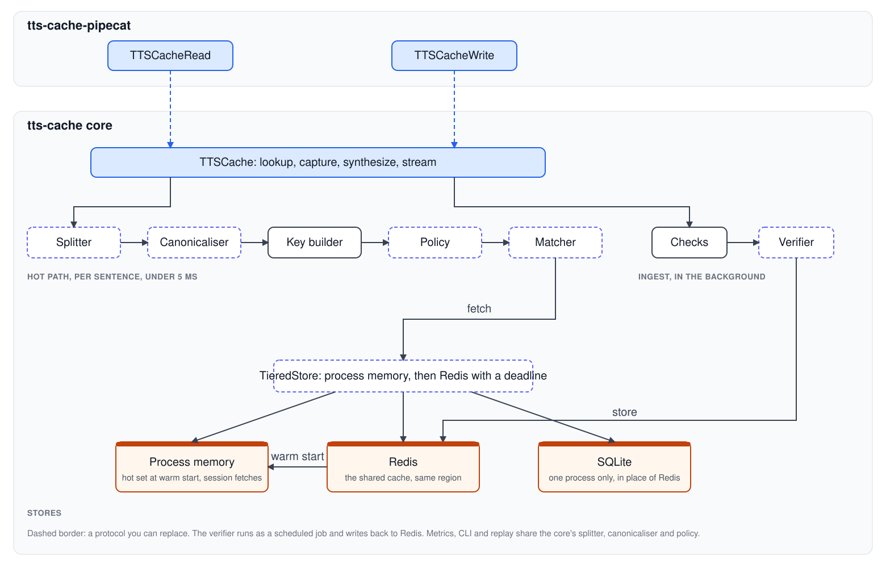
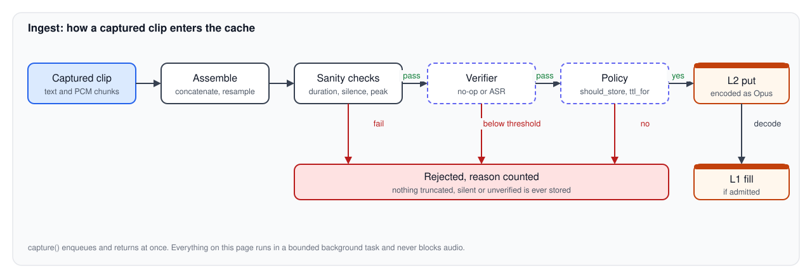
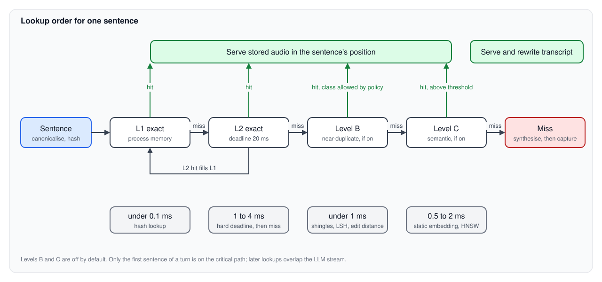
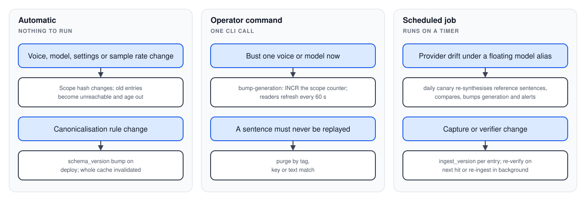
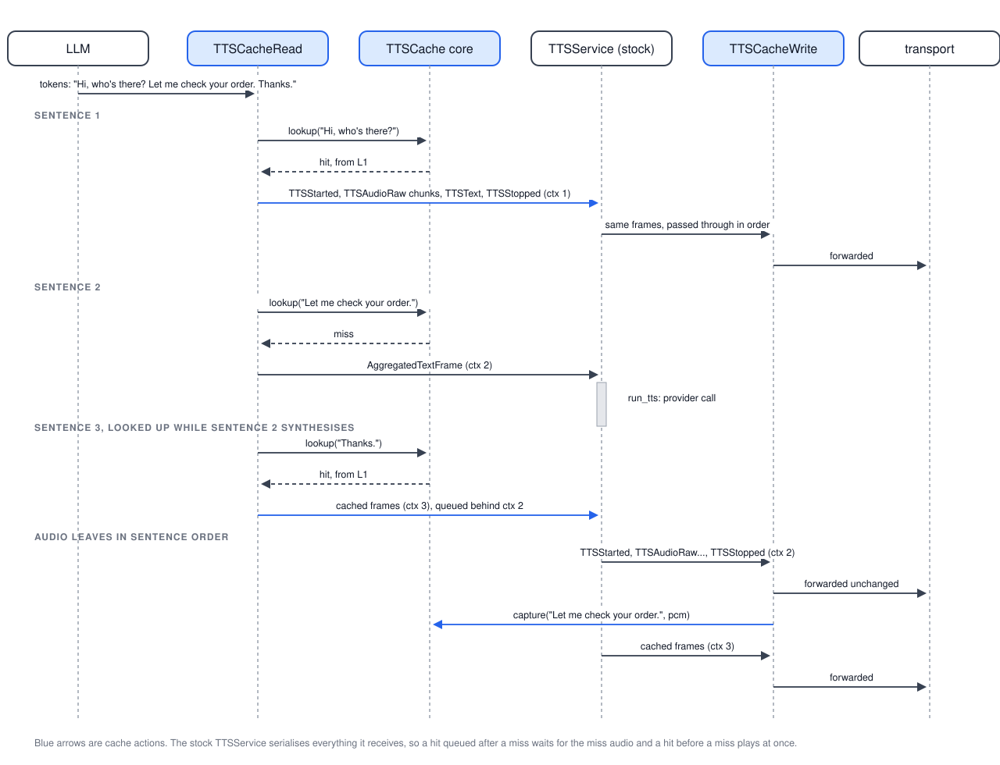

# TTS Caching


## Contents

1. [The problem](#1-the-problem)
2. [The solution](#2-the-solution)
3. [Components](#3-components)
4. [Storing and updating the cache](#4-storing-and-updating-the-cache)
5. [Matching: exact and similar](#5-matching-exact-and-similar)
6. [Multilingual support](#6-multilingual-support)
7. [Invalidating the cache](#7-invalidating-the-cache)
8. [Framework, provider and domain agnostic](#8-framework-provider-and-domain-agnostic)
9. [Measurement](#9-measurement)
10. [Success criteria](#10-success-criteria)
11. [Integration: Pipecat](#11-integration-pipecat)

---

## 1. The problem

A voice agent speaks by sending text to a text-to-speech (TTS) provider and streaming the returned audio to the user. You pay two costs on each request:

- Money. Providers bill per character. A sentence costs the same whether it is the first or the ten-thousandth time the agent has said it.
- Latency. The provider's time to first byte is 100 to 400 ms per request. Each sentence the agent starts waits that long before the user hears anything.

Agents repeat themselves. They say the same greetings, acknowledgements, standard explanations, closings and scripted prompts across sessions, in the same voice. On real traffic the repeats make up anywhere from a few percent to half of all characters spoken, depending on how scripted the agent is. Today the provider synthesises each repeat from scratch.

A cache that recognises a sentence already synthesised with the same voice, and plays the stored audio, removes both costs for that sentence. It must not change what the user hears, must not add latency on a miss, and must not depend on a particular framework, provider or application.

## 2. The solution

A sentence-level TTS cache in two packages:

- `tts-cache`: a framework-free core. Text in, audio out. It has two primitive operations: `lookup(text)` returns stored audio or nothing, and `capture(text, audio)` stores audio the provider has just synthesised.
- `tts-cache-pipecat`: the Pipecat integration. You place two frame processors around the Pipecat TTS service, using the stock class for REST services and a thin subclass from this package for websocket services (11.8). Pipecat is the first host because most teams build voice agents on it. Other hosts follow on the same core.


How one turn flows:

1. The LLM streams tokens. The read side splits them into sentences.
2. For each sentence the read side canonicalises the text, builds a key from the text plus the voice identity, and looks it up. A hit returns stored audio from process memory, or from Redis in one round trip that the prefix prefetch in section 5 starts while the sentence is still streaming.
3. On a hit, the read side plays the audio in the sentence's position. The provider never sees the sentence.
4. On a miss, the sentence goes to the provider as usual. The write side captures the returned audio, checks it, and stores it for next time.
5. The read side looks up a finished sentence while the LLM is still writing the next one. The lookup can add delay only for the first sentence of a turn, and a deadline caps that delay.

Design principles:

1. Correctness over speed. A hit never produces different words, a different voice, a truncated clip, or audio out of order. The cache treats anything uncertain as a miss.
2. Fail Open: if anything in the cache goes wrong, the application behaves as if you had not installed the cache.
3. Framework-free core with thin adapters. The core knows nothing about frames or pipelines.
4. Provider agnostic. The cache does not use word timestamps or any provider's API.
5. Domain agnostic. The core has no application concepts. You group beyond voice identity with tags and policies you supply.
6. Measured. The cache counts each hit and miss by characters, and the offline replay harness and the synthetic benchmark run the same code as the runtime.

### Fail open, defined

Fail open means that if anything in the cache goes wrong, the application behaves as if you had not installed the cache. The cache can remove a provider call. It cannot add a failure, a delay beyond its deadline, or wrong audio.

| Failure | What the cache does | What the user hears |
|---|---|---|
| shared store unreachable | lookup returns a miss at once; the ingest queue drops the capture; the cache logs the error once per minute | normal synthesised audio |
| shared store slow | lookup gives up at its deadline (default 20 ms) and returns a miss | normal synthesised audio |
| voice or settings unknown | the cache cannot build a key and passes the sentence through untouched | normal synthesised audio |
| user interrupts mid-sentence | the write side discards each partial capture for that turn; the store never receives a truncated clip | the interruption behaves as it does today |
| captured clip fails a check (wrong duration, silence, failed verification) | ingest rejects it | nothing; the clip already played live |
| the read side's prediction of the provider text disagrees with what the service sent (`on_tts_request`) | ingest rejects the capture, counts a `key_mismatch`, and the adapter stops serving hits for that scope until restart | nothing; the clip already played live |
| bug or exception anywhere in the cache | the adapter catches it at its boundary, counts it, and the sentence proceeds as a miss | normal synthesised audio |

A broken cache and an absent cache differ in one way you can observe: a metric.

## 3. Components




| Component | Responsibility | Shipped |
|---|---|---|
| `TTSCache` facade | the public API; owns the hot path and the ingest queue | one implementation |
| Sentence splitter | turns a token stream into sentences, the unit of caching | sentencex with per-language abbreviation overrides |
| Canonicaliser | per-script text normalisation before hashing | Latin and Indic rule sets |
| Key builder | scope hash (voice identity) plus canonical text hash | one implementation |
| Policy | whether to look up, whether to store, TTL, allowed match levels | `AlwaysCache`, `Shadow`, `Probation`, `MinChars`, `SkipIfMatches`, `TurnPosition`, `SpeakFramesOnly`, `LevelB`, `Namespace`, `RateLimit`, composed with `AllOf`, `AnyOf`, `ByTag` |
| Similarity matcher | finds a stored entry for a sentence | `ExactMatcher`; `NearDuplicateMatcher` and `SemanticMatcher` as extras |
| Stores | Redis as the shared cache; process memory holding the hot set loaded at warm start plus this session's fetches; SQLite for a single process; tiered access with a deadline | `RedisStore`, `MemoryStore`, `SQLiteStore`, `TieredStore` |
| Clip verifier | gate on what enters the cache | `NoopVerifier`; `ASRVerifier` as an extra |
| Metrics sink | counters, latencies, structured events | structured logs; Pipecat `MetricsFrame` in the adapter |
| Host adapters | translate a framework's streaming model into `lookup` and `capture`, and hand the core the text the provider receives, not the LLM's text | Pipecat |

### The unit: a sentence

The cache works on sentences. A sentence is what a provider synthesises as one request, so a stored clip carries its own prosody. It is short enough to recur across sessions; a whole turn almost never does. The splitter builds on sentencex with the same look-ahead rules Pipecat uses, so each host produces the same boundaries. The cache stores scripted utterances the application sends on its own, outside the LLM, as whole clips.

### The key: what counts as "the same audio"

Two sentences may share audio only if everything that affects the sound is identical. That set is the scope, and the scope is part of the key. Everything else is a tag.

| Scope field | Example |
|---|---|
| `service` | `sarvam`, `elevenlabs`, `openai` |
| `model` | `bulbul:v3`, `eleven_v3`, `eleven_v4`, `eleven_v4_turbo`, `eleven_flash_v2_5`, `gpt-4o-mini-tts` |
| `voice` | `shubh`, `priya`, `Rachel`, `21m00Tcm4TlvDq8ikWAM`, `alloy` |
| `language` | `hi-IN`, `en-IN`, `ta-IN`, `en-US` |
| `sample_rate`, `channels` | `24000`, `1`; `16000`, `1` |
| `settings` | `{"pace": 1.0, "temperature": 0.6}` for Sarvam; `{"stability": 0.5, "similarity_boost": 0.75, "style": 0, "speaker_boost": true}` for ElevenLabs; `{"speed": 1.1}` for OpenAI. Only settings that change the audio; timeouts and buffer sizes stay out |
| `schema_version` | `3` |
| `generation` | `7` |

```
scope_hash = sha256(canonical_json(scope))[:16]
key        = tts:{scope_hash}:{sha256(canonical_text)[:24]}
```

`canonical_text` is the canonical form of the text the host sends to the provider, after any filtering or transformation the host applies on the way, never the LLM's raw output. Section 11.3 shows why for Pipecat: the same raw sentence can reach the provider as different strings, and different raw sentences as the same string.

Tags are free-form `str -> str` pairs you supply (tenant, flow, campaign). The store keeps them with the entry for analytics and purges; they stay out of the key. By default nothing beyond the scope isolates entries, so an identical sentence in the same voice serves each caller, which maximises the hit rate. If you need isolation, use the `Namespace(tag)` policy, which folds a tag into the key.

## 4. Storing and updating the cache

### 4.1 Write path




`capture` enqueues and returns at once; the steps above run in a bounded background task. A burst of misses cannot block audio or grow memory without limit.

The verifier guards what enters the cache. In the first release it is a no-op and the guarantee rests on the capture being exact, which section 11 explains. When a clip is stored, the optional `ASRVerifier` checks that the sentence matches the audio. It transcribes the clip with a small speech-to-text model and rejects the clip if the transcript disagrees.

### 4.2 Storage tiers

| Tier | What | Format | Where it lives | Role |
|---|---|---|---|---|
| Redis, `RedisStore` | every verified clip and its metadata; the cache itself | Opus | the same region as the agent containers, with persistence on, plus a nightly `export` to object storage for rebuilds | every lookup that process memory cannot answer, and every capture; a sentence captured in one session hits in the next session on any container |
| Process memory, `MemoryStore` | the hot set loaded from Redis at warm start, within a byte budget, plus every clip this session fetched or decoded, plus the hot set's canonical texts for the prefix prefetch | raw PCM, decoded on first use | the process | hits with no network call, including the first sentence of a fresh container; keeps serving the hot set if Redis stalls mid-session |
| SQLite, `SQLiteStore` | the same data as Redis, for one process | Opus | one file on local disk | development, tests and a single server; takes the place of Redis in that profile and nowhere else |

### 4.2a Deployment profiles

Each tier is a `CacheStore`. The same library serves three deployment shapes by choosing which tiers are present.

| Profile | Shared cache | Process memory | Network calls on the hot path |
|---|---|---|---|
| one process (development, tests, a single server) | `SQLiteStore`, one file | hot set loaded from SQLite at warm start | none |
| serverless containers, including one container per session | `RedisStore` in the same region as the containers | hot set loaded from Redis at warm start, plus this session's fetches | one deadline-bounded round trip per sentence that process memory cannot answer; the prefix prefetch in section 5 starts it before the sentence ends |
| long-running fleet | `RedisStore` in the same region | same, and it fills further as the process lives | same |

`SQLiteStore` holds metadata in relational tables and cached text in an FTS5 table, which powers `inspect` and `purge --match`; against Redis the same commands run over the metadata keys. `RedisStore` works with Valkey and any Redis-protocol server. Postgres is a later addition through the same protocol; Memcached is out of scope because it cannot hold metadata.

Serverless container lifecycle:

1. Warm start: one pipelined Redis request loads the top entries of the `tts:hot` set for the process's scopes, capped by bytes (default 4 MB of Opus, about 250 clips), together with their canonical texts. The clips decode on first use, so the warm start adds a few hundred milliseconds of network transfer to a container start that already takes seconds, and no decode time. A failed warm start is a cold cache, not an error. With one container per session this step runs once per session.
2. Session: a lookup checks process memory first. A miss there goes to Redis with a hard deadline, and the prefix prefetch usually starts that call while the sentence is still streaming. Within one session a sentence rarely repeats; the hits come from the hot set loaded at warm start and from Redis, which holds what every earlier session captured.
3. Capture: the container encodes to Opus and writes the clip and its metadata to Redis in the background. This is the only ingest work done in the container.
4. Shutdown: a hook drains the capture queue with a short timeout (default 2 s). Anything still queued is dropped and counted; it is a cache, so the loss is one future hit.
5. Elsewhere, on a schedule: a verifier worker reads unverified entries from Redis, runs the checks and `ASRVerifier`, and marks them; the nightly `export` copies Redis to object storage so a lost instance can be rebuilt with `import`. Both are small scheduled functions on the same platform as the agent.

Freshness: a sentence first said at 10:00 and captured is in Redis by 10:00 and a few seconds, so the next session on any container hits it. Nothing waits for a build.

Where to put Redis, on any platform: in the same cloud region as the containers, measured, not assumed. "Same region" on a label is not enough: a Modal region named `ap-south` and an ElastiCache instance in `ap-south-1` sit in different networks, and the round trip between them is whatever the path between those networks costs. The gate is a number. `tts-cache ping` from a container reports the Redis round trip p50 and p99; the rule is a p99 under 10 ms. Over that, move Redis: a managed Redis or Valkey from the same cloud the containers run in, in the containers' region, or a Redis hosted by the container platform's own provider. If no placement passes, run without the cache rather than with a slow one, because the miss-overhead metric in 9.1 would show every sentence paying the round trip.

### 4.2b Audio format and compression

Process memory holds raw PCM so a hit is a memory copy with no decode. Redis and SQLite hold compressed clips because raw PCM makes them far larger than they need to be. The size per clip, for 16-bit mono and a 4 second average sentence (about 60 characters):

| | PCM 16 kHz | PCM 24 kHz | Opus 32 kbps | FLAC |
|---|---|---|---|---|
| per second | 31 KB | 47 KB | 4 KB | about 20 KB at 24 kHz |
| per clip | 125 KB | 188 KB | 16 KB | about 80 KB |
| 10,000 clips | 1.2 GB | 1.8 GB | 156 MB | about 800 MB |
| 100,000 clips | 12 GB | 18 GB | 1.5 GB | about 8 GB |

Options, set per store:

- `opus` (default): 32 kbps, transparent for speech, about 12 to 1 against 24 kHz PCM. Decoding costs about 2.3 ms per second of audio, about 9 ms for a 4 second clip at 24 kHz on an Apple M4 Pro, measured on real TTS output. A hit does not wait for the whole clip: `Hit` exposes the PCM as a stream of 20 ms chunks, the first 200 ms decode in about 0.5 ms, and the rest decodes in a worker thread ahead of playback. Time to first audio on a hit is therefore the fetch plus under 1 ms, and the full decode cost is paid off the critical path.
- `flac`: lossless, about 2 to 1. For deployments that refuse a lossy codec.
- `pcm`: no encode or decode cost; for tests and for stores on fast local disk where size does not matter.

Ingest encodes once; a fetch into process memory decodes once. The scope key includes the pipeline sample rate, so a clip never serves a different rate.

### 4.2c Sizing

Distinct sentences, not sessions, drive Redis size: a thousand sessions that say the same 500 sentences cost 500 entries. Hit frequency follows a Zipf curve, so a few hundred sentences account for most hits, and the warm start needs only that hot set. The default 4 MB warm start holds about 250 Opus clips, which decode to about 47 MB of PCM at 24 kHz if every one of them plays.

Two of the numbers below belong to the library and hold for everyone: codec size and decode time (number 4) and the lookup overhead the benchmark measures. The other four belong to each deployment, because they depend on the agent's prompt and traffic. The library ships the tools to measure them, and defaults that are safe across the range the benchmark sweeps; each deployment reads its own values from the replay harness or a shadow run.

The replay harness and the runtime metrics produce the numbers that set the budgets:

1. Distinct sentence count and total audio seconds at steady state, per language and scope.
2. Clip duration distribution, since a few long sentences hold most of the bytes.
3. The hot set: how many entries cover 80 and 95 percent of hits. That sets the warm start budget.
4. Measured Opus size and decode time on real TTS output at each sample rate.
5. Hit rate served from the warm start set at 2, 4 and 8 MB, and from Redis beyond it, under the replay.

Data model (SQLite for the single-process store; the Redis layout maps each table to a key family):

```
entries   (scope, hash) -> audio blob, codec, sample_rate, duration_ms, bytes, text, canonical_text,
                           language, created_at, last_hit_at, hit_count, expires_at, verify_score, ingest_version
tags      (key, value, scope, hash)            for purges by tag
entries_fts(text)                               FTS5 over cached text, for inspect and purge --match
generation(scope) -> int                        generation counter
```

In Redis the same data lives in `tts:{scope}:{hash}` for audio, `tts:meta:{scope}:{hash}` for metadata, `tts:tag:{k}={v}` sets, `tts:gen:{scope}` and a `tts:hot:{language}:{scope}` zset ordered by decayed hit count, which the warm start reads.

`TieredStore` checks process memory, then Redis (or SQLite) with a hard deadline; a hit from the shared tier decodes and stays in process memory for the rest of the process. It coalesces concurrent misses of the same key within a process, so a sentence that many sessions say at once gets stored once. `CacheStore` is a protocol, so you can add a backend without touching the engine.

### 4.3 Updating an entry

Audio is immutable; metadata is mutable. Each hit touches the entry in the background: `last_hit_at`, `hit_count`, the sliding TTL, and the hot-set score. Re-ingesting a key, for example after a verifier upgrade, replaces the audio in one write and resets `verify_score` and `ingest_version`.

### 4.4 Expiry

- Probation. Ingest stores a new clip with a short TTL (default 48 hours). Its first hit promotes it to a long sliding TTL (default 30 days) that each later hit refreshes. Most sentences are singletons and expire on their own; the cache keeps anything that repeats once. This beats "store on second sight" because the cache serves the first repeat.
- The replay harness (section 9) calibrates both values from the application's own gap between a sentence's first and second occurrence.
- Policies can give short fixed TTLs to classes of sentence, such as anything containing a date.

### 4.5 Eviction under memory pressure

- Process memory: the warm start set stays for the life of the process. Clips fetched during the session sit behind a second byte budget with W-TinyLFU size-aware scoring (frequency times characters saved, divided by bytes), which only matters in a long-running process; a one-session container never fills it.
- Redis: `allkeys-lfu` with time decay, which keeps the sentences that repeat and drops singletons once probation (4.4) has not already removed them. Run separate instances per language where you need isolation.
- SQLite: a sweep task runs on a timer, deletes expired entries, and when the file exceeds its byte budget deletes the lowest-scoring entries (decayed hit count times characters saved, divided by bytes) until it is under budget.

### 4.6 Policy: the strategy layer

Each "should we" decision goes through one interface, so you can change behaviour without touching the engine.

```python
class CachePolicy(Protocol):
    def should_lookup(self, s: SentenceCtx) -> bool
    def should_store(self, s: SentenceCtx, clip: Clip) -> bool
    def ttl_for(self, s: SentenceCtx, existing: EntryMeta | None) -> int
    def allowed_levels(self, s: SentenceCtx) -> set[Level]
    def on_hit(self, s: SentenceCtx, meta: EntryMeta) -> None
    def on_interruption(self, turn: TurnCtx) -> None
```

| Built-in | Decides |
|---|---|
| `AlwaysCache(ttl)` | everything; baseline and tests |
| `Shadow` | look up and count, never serve; for rollout and A/B |
| `Probation(short, long)` | the TTL scheme in 4.4 |
| `MinChars(lo, hi)` | skip very short and very long sentences |
| `SkipIfMatches(patterns)` | never store sentences matching the application's PII or variable-content patterns |
| `TurnPosition(first_n, last_n)` | only turn-initial and turn-final sentences |
| `SpeakFramesOnly` | only scripted utterances, not LLM output |
| `LevelB(classes)` | which near-duplicate classes may be served |
| `Namespace(tag)` | fold a tag into the key to isolate entries |
| `RateLimit(stores_per_minute)` | bound ingest write volume |

You compose them with `AllOf`, `AnyOf`, and `ByTag(tag, {value: policy}, default)`. The default is `AllOf(Probation("48h", "30d"), MinChars(3, 400))`.

## 5. Matching: exact and similar

An LLM response cache can serve a paraphrase. A TTS cache must say the words the LLM produced, or the transcript and the conversation context disagree with what the user heard. So the cache splits matching into levels by what you may do with a match.




### Level A: exact match on canonical text

A hash lookup, under 0.2 ms in process, on by default. This level does most of the work. "Canonical" means after the normalisation in section 6, so differences that cannot change the spoken result (whitespace, Unicode form, digit script, terminal punctuation style) match here.

### Level B: near-duplicate text (`[similarity]` extra)

Targets: "Sure, let me explain." vs "Sure, let me explain that."; "Thanks, Alex." vs "Thanks, Sam."; "Okay." vs "Okay, okay."

1. Character n-gram shingles (n = 3 to 5) over canonical text. Characters rather than words, so the method behaves the same across scripts, including agglutinative languages and conjunct-heavy scripts.
2. MinHash signature (128 permutations) and an LSH band index per `(language, scope)` held in memory over the hot set only. The long tail is reachable by exact hash only, which keeps the index bounded.
3. The matcher verifies candidates by normalised edit distance, then classifies a token-level diff as `punctuation`, `filler` (a leading or trailing token from a per-language filler list), `slot` (one contiguous span that looks like a name, number, date, amount or product), or `other`.

| Class | Served? | Use |
|---|---|---|
| punctuation | yes, if the policy allows it for the language | canonicalisation rules you do not yet trust; serving them under a flag measures them on live traffic before you promote them to Level A |
| filler | only if the policy allows dropping the filler | otherwise analytics |
| slot | never | a listener can hear a synthesised span spliced into stored audio |
| other | never | miss |

Total cost under 1 ms. The diff histogram is useful on its own: it tells you how many characters you lose to names, numbers and filler, which is the evidence for cache-aware prompting, such as a phrase bank for the agent's fixed moves.

### Level C: semantic paraphrase (`[similarity]` extra, on by default where a language passes its check)

- **An encoder per language through a routing map.** The default encoder is `multilingual-e5-small` run through onnxruntime on one CPU thread from the ONNX file the model's own hub repository ships (384 dimensions, mean pooling, L2 normalised). It costs 2.3 ms per sentence at p50 and 3.1 ms at p99 on an M4 Pro, 2.8 and 3.6 ms with the index probe and both vetoes included. The static model2vec `potion-multilingual-128M` (0.1 ms per sentence) remains a routable alternative. The choice is measured, not assumed: on 200 fixture pairs per language the static model accepts 57, 21 and 21 percent of paraphrases in English, Hindi and Tamil, because it scores a Hindi or Tamil paraphrase that swaps native words for English loanwords at 0.2 to 0.5; the contextual encoder accepts 100, 94 and 87 percent. Level C runs only after Levels A and B have missed, so its cost lands on misses, where the provider's 130 to 2,000 ms follows anyway, and on sentences after the first, where lookups overlap the LLM stream.
- An in-process HNSW index per `(language, scope)` over the hot set.
- **Two vetoes between the encoder and the serve decision.** The encoder proposes the nearest stored sentence; the vetoes dispose. Both exist because every sentence encoder, static or contextual, scores "₹2,349" against "₹2,439", or "Thursday" against "Tuesday", at 0.97 or above, the same as a true paraphrase.
  - The *slot veto* reduces both sentences to their facts: numbers (digits in any script, normalised to ASCII, and the spelled-out small numbers of each language), a currency sign beside a number, date and time words from the per-language lexicon, person names from the lexicon or by Latin capitalisation, and words in a script other than the language's own. Lexicon words match with a case suffix attached ("मार्चमध्ये", "ಮಾರ್ಚ್‌ನಲ್ಲಿ"), since Indic nouns and names inflect. A bare currency word, a "now" word or the word "date" is wording, not a fact. A negation word, or a Dravidian negative verb ending, marks the sentence as negated, so a negated and a non-negated sentence never match however the negation is phrased. The candidate serves only if the two sets are identical. 27 µs per sentence.
  - The *span veto* compares the two token sequences: if they differ by exactly one contiguous substitution of one or two tokens, or of up to four tokens containing a digit, or by one insertion or deletion of one or two tokens that are not fillers, the candidate is refused. The insertion rule is what stops "was successful" against "was not successful", which every encoder scores at 0.93 to 0.97. That shape is a changed fact in an otherwise identical sentence, never a paraphrase, which rewrites several places at once. It needs no lexicon, so it catches the names the slot detector cannot see. A single span of three or more words with no digit is a rewording: in Kannada, Malayalam and Telugu a whole clause is two or three agglutinated words, and a four-token rule refused a fifth of their paraphrases.
  - Together they stop 100 of 100 slot near-misses and every negation decoy in all twelve fixture languages. The cost is recall: 2 to 11 paraphrases per 100 are refused by one veto or the other, mostly a dropped time-of-day word, a one-word rewording, or a paraphrase that negates on one side only ("unable to find" against "could not find").
- Per-entry acceptance thresholds, starting at a floor of 0.90 cosine. The floor is not what keeps changed facts out, the vetoes are; it guards the facts no detector recognises.
- A per-language acceptance check before Level C routes a language: 200 sentence pairs, half paraphrases and half near-misses with one changed slot. The check applies both vetoes, then chooses the lowest threshold at or above the floor that rejects every near-miss the vetoes let through, and reports the share of paraphrases accepted. A language passes at 80 percent with no near-miss accepted. English, Hindi and Tamil pass with the default encoder and are routed; the other candidates are unchecked and off. The same check gates any replacement model.

Hard rule: when the cache serves a Level C hit, the stored text replaces the LLM text everywhere downstream. `Hit.spoken_text` carries it, and each adapter must write it to the transcript and conversation context, so the system records the words it spoke. You decide through policy whether your agent may say a near-equivalent line.

### Latency budget

| Step | Where | Cost |
|---|---|---|
| canonicalise and hash | in process | under 0.1 ms |
| process memory lookup | in process | under 0.1 ms |
| first 200 ms of a stored clip decoded | in process | about 0.5 ms; the remaining decode runs in a worker thread ahead of playback, about 2.3 ms per second of audio |
| Redis fetch | network | one round trip, measured per deployment with `tts-cache ping`; hard deadline 20 ms; started early by the prefix prefetch where the hot set allows |
| Level B probe and verify | in process | under 1 ms |
| Level C embed, probe and vetoes | in process, after A and B miss | 2.8 ms p50, 3.6 ms p99 (contextual encoder); 0.1 ms (static) |

Only the first sentence of a turn sits on the critical path; later lookups overlap the LLM streaming.

### Why a shared store does not cost latency

The lookup is on the critical path only for the first sentence of a turn, and it competes with the provider's time to first byte, not with zero. For that sentence, with a provider at 150 to 400 ms and a Redis round trip of `rtt`:

| Case | Time to first audio | Against no cache |
|---|---|---|
| no cache | provider TTFB | baseline |
| hit from process memory | under 1 ms | 150 to 400 ms faster |
| hit from Redis, prefetched | under 1 ms once the sentence completes, because the fetch ran while it streamed | 150 to 400 ms faster |
| hit from Redis, not prefetched | `rtt` | 150 to 400 ms faster |
| miss | TTFB plus `rtt`, bounded by the 20 ms deadline | slower by `rtt` |

Expected change per first sentence is the hit rate times the saving minus the miss rate times `rtt`. The break-even hit rate is `rtt` divided by TTFB: at a 200 ms TTFB and a 2 ms round trip it is 1 percent, and at a 10 ms round trip it is 5 percent. Openers alone sit near 100 percent. The benchmark prints this table with your provider and your measured round trip, and the only number this document does not supply is `rtt`, because it belongs to your placement and `tts-cache ping` measures it.

Prefix prefetch takes the round trip off the critical path for the sentences that matter most. The warm start brings the hot set's canonical texts into memory, a few kilobytes. While a sentence streams, the read side canonicalises the prefix so far and checks it against that list. When exactly one hot-set sentence starts with the prefix, the read side fetches that clip from Redis at once and parks it. When the sentence completes, the read side builds the key as it always does and plays the parked clip only if the key is the parked clip's key. Any other ending discards the parked clip and the sentence takes the normal path. Nothing plays because of a prefix; the prefetch only moves the Redis read earlier in time. The LLM takes 150 to 300 ms to stream a sentence, which is longer than any round trip that passes the placement rule, so a prefetched hit costs no network time at all. A wrong guess costs one wasted Redis read, bounded by two rules: fetch only when one candidate remains, and at most one fetch per sentence.

What this does not cover: a sentence outside the hot set still pays one round trip on a Redis hit and on a miss. The placement rule in 4.2a keeps that round trip small, the deadline keeps it bounded, and the miss-overhead metric in 9.1 is the alarm if either stops holding.

## 6. Multilingual support

Three places need language awareness, and all three are per-script plug-ins with a registry.

### Sentence splitting

The splitter must know each language's terminators and abbreviations: Latin `.?!`, Indic danda `।` and `॥`, CJK `。！？`, plus abbreviations ("Dr.", "Rs."), decimals, and code-mixed text with Latin punctuation inside another script. sentencex covers most of this; you can override rules per language, and fixtures test each override.

### Canonicalisation

The canonicaliser runs before hashing. Each rule is a named function you can toggle on its own, grouped by script. Default order:

1. Unicode NFC, then script-specific normalisation where NFC is insufficient: Indic nukta decomposition, zero-width joiner and non-joiner cleanup; Arabic presentation forms; CJK width folding.
2. Native digit blocks to ASCII digits (Devanagari, Gujarati, Gurmukhi, Odia, Bengali, Tamil, Telugu, Kannada, Malayalam, Arabic-Indic, fullwidth).
3. Sentence terminators unified (`।`, `॥`, `。` to `.`); punctuation runs collapsed (`!!` to `!`).
4. Whitespace collapsed and trimmed; quote and dash variants unified; emoji and markdown artefacts stripped. The markdown rule serves hosts with no filter stage of their own; in Pipecat the markdown filter has already run by the time the text is keyed (11.3).
5. Trailing `.` dropped. `?`, `!` and `,` kept: they change prosody.
6. Lowercase for cased scripts, unless the whole sentence is upper case. Most Indic scripts, and CJK, have no case.

Changing any rule bumps `schema_version`, which invalidates the whole cache. The replay harness reports the incremental hit rate each rule buys per language, so a number justifies each rule.

### Similarity

Character shingles make Level B script-independent. Filler lists and slot patterns are per language.

Level C coverage. Routing map as of 2026-10-18: English, Hindi, Bengali, Assamese, Punjabi, Gujarati, Marathi, Odia, Tamil, Telugu, Kannada and Malayalam route to `multilingual-e5-small`, each having passed the acceptance check with the vetoes (85 to 100 percent of paraphrases accepted, no near-miss accepted, on 200 fixture pairs per language). Odia and Assamese are outside both encoders' training data, yet the check passes at 89 and 98 percent, because the vetoes carry the safety and the encoder only has to rank paraphrases above 0.90, which XLM-R's shared script coverage manages. Any other language gets Levels A and B until its fixture set exists and passes. Larger encoders (bge-m3 at 81 ms per sentence, LaBSE) are not an option for the hot path; the slot and span vetoes apply to any encoder, since a transformer also scores a one-digit change as near-identical.

Splitter check on the same date: sentencex splits on the danda for Hindi, Marathi, Punjabi, Bengali, Assamese and Odia and on Latin terminators for the rest, but splits "डॉ. शर्मा" at the abbreviation and merges "Acme Inc. Thanks" into one sentence. Per-language abbreviation overrides (titles, currency, company suffixes) are therefore a first-release deliverable with fixtures per language.

The first release ships Latin and Indic rule sets with per-language fixtures; CJK and Arabic follow. Adding a language takes a rules file and a fixture file, with no engine change.

## 7. Invalidating the cache

Three questions, three mechanisms. Each invalidation trigger has one owner.




| Question | Mechanism | Section |
|---|---|---|
| is this entry still correct? | scope hash, schema version, generation counter, tag purge, canary, ingest version | above |
| is this entry still worth keeping? | probation and sliding TTL | 4.4 |
| which entry goes when memory is full? | byte budgets in process memory, LFU with decay in Redis | 4.5 |

A change to the agent's prompt or script needs no invalidation. Keys are text-based, so sentences that still occur keep their hits and sentences that changed miss.

## 8. Framework, provider and domain agnostic

### Framework

The core's contract is text in, PCM out, through four methods on `TTSCache`:

```python
hit = await cache.lookup(text, tags=...)              # Hit(pcm_stream(), sample_rate, spoken_text, meta) | None; pcm_stream yields 20 ms chunks as they decode
await cache.capture(text, pcm, sample_rate, tags=...) # enqueue for ingest; never raises
audio = await cache.synthesize(text, provider_fn)     # lookup; on miss call provider_fn, capture, return
async for sentence, chunks in cache.stream(tokens, provider_stream_fn): ...   # split, then per sentence
```

Sync variants exist for non-async hosts. Nothing in the core imports a framework. The host contract has one rule beyond the signatures: the `text` you pass to `lookup` and `capture` is the text you send to the provider. If the host filters or transforms text between the LLM and the provider, do that before `lookup`, so the key describes the audio. An adapter maps the host's streaming model onto `lookup` and `capture` and emits whatever the host needs for transcripts and metrics. The Pipecat adapter is a few hundred lines of frame handling (section 11).

### Provider

The capture path needs to know which audio bytes belong to which sentence. The cache does not use word timestamps, which only some providers return, and does not call any provider API. It relies on the host handing it one sentence's audio at a time, which each host can do: a plain SDK call returns that, and Pipecat tags each audio frame with a per-sentence context id. Ingest absorbs provider differences in sample rate and codec by resampling to the pipeline rate; the scope key keeps audio from one provider away from another.

### Hosting

The agent process and the cache live in different places. A serverless container has no disk that survives and may be killed mid-session; a fleet has many processes sharing one cache; a developer has one process and a laptop. The profiles in 4.2a cover all three with the same code: a fresh process loads the hot set at warm start and serves hits from its first sentence, every network call is deadline-bounded and starts early where the prefix prefetch can see it, and a dying process loses at most the captures of its last two seconds. One container per session is the hardest case and the design is built for it. Sentences repeat across sessions, not within one, so the cache that matters is Redis, and process memory exists to serve the hot set without touching the network. The one requirement on you is placement: Redis in the containers' region, with the round trip measured by `tts-cache ping` and under 10 ms at p99. That rule is the same on Modal, Cloud Run, Fly, Lambda or a VM, and the ping command is how you check it on each.

### Domain

The core has no notion of tenant, campaign, persona, flow or any other application concept. You express domain rules through:

- tags on each lookup and capture, for analytics and purges;
- policies, including `ByTag` routing and `Namespace` isolation;
- their own `SkipIfMatches` patterns for content that must not be stored.

### Packaging

`pip install tts-cache` includes the SQLite backend and Opus codec. Extras: `[redis]`, `[similarity]` (datasketch, model2vec, hnswlib), `[verify]` (speech-to-text backend), `[cli]`. `pip install tts-cache-pipecat` pulls the core.

## 9. Measurement

Three instruments share the production canonicaliser and policy code, so their numbers agree.

### 9.1 Runtime metrics

| Metric | Why |
|---|---|
| hit rate, character-weighted, per language, scope and tag | characters cost money; this maps to the bill |
| hits by level (A, B class, C), misses, skips by policy, fail-open events | shows where hits come from and whether the cache is degrading |
| lookup latency p50 and p99, split process memory vs Redis, and the share of Redis hits the prefetch served | proves the cache is fast enough to save latency as well as cost, and that the prefetch is doing its job |
| miss overhead: time from sentence complete to the sentence reaching the provider, with the cache on vs off, p50 and p99 | the latency the cache adds when it does not help; it must stay under the measured Redis round trip, and a deadline hit shows up here as a 20 ms spike |
| time to first audio per sentence, hits vs misses, and per turn | the latency saving as the user experiences it |
| stores, rejects by reason including `key_mismatch`, bytes in process memory and Redis, evictions, warm start size and duration | ingest health and capacity; a non-zero `key_mismatch` means the adapter's view of the provider text has drifted from the host's |

Each hit and store emits one structured event (key, level, tags, chars, duration, timing). `MetricsSink` is a protocol: structured logs by default, Pipecat `MetricsFrame` in the adapter, Prometheus and OpenTelemetry as extras. The `Shadow` policy and a per-session on/off switch give you A/B comparison out of the box.

### 9.2 Replay harness

`tts-cache replay --log events.jsonl --policy ...` runs the production splitter, canonicaliser and policies over an application's own transcript log in time order and reports: hit rate as the cache warms and at steady state, incremental hit rate per canonicalisation rule, Level B diff histogram, Level C ceiling with a reviewable sample, steady-state size, the first-to-second-occurrence gap for TTL calibration, and the share of hits the warm start set serves at each byte budget. The log format is documented, so you can export to it from any application.

### 9.3 Synthetic benchmark

`tts-cache bench` answers "if the cache is fast, do we save both latency and cost?" with a controlled experiment you can run against your own provider.

- Corpus: the generator draws N sentences (default 200) from a pool sized so the fraction of repeats equals a target repetition rate r, with Zipf-distributed repeats so a few sentences recur often and the rest once or twice. It samples lengths from a configurable range (default 20 to 160 characters), takes pool text from a bundled multilingual list or your own log, groups sentences into turns of 1 to 5, sweeps r over {0, 0.1, 0.25, 0.5, 0.75, 0.9}, and seeds each run.
- Provider modes: the real provider with your scope, run once with the cache off and once cold-on so the run also measures the ramp; and a simulated provider with a configurable time-to-first-byte distribution (default lognormal, median 250 ms) and per-character price, so it runs in CI without spend and you can vary provider latency apart from cache latency.
- Measured per run: characters sent to the provider and cost; hit rate; lookup latency p50 and p99 by tier; per-sentence and per-turn time to first audio, hits vs misses; bytes stored and ingest rejects.
- Output: a table per r, cache off vs on, both provider modes, and a plot of cost and p50 time to first audio against r. It runs in both the Pipecat host (fake transport, real pipeline) and the plain core, so you see adapter overhead on its own.

## 10. Success criteria

| Criterion | Target | Measured by |
|---|---|---|
| correctness | zero served clips with wrong words or wrong voice in the seam and verifier audits; zero out-of-order audio in pipeline tests | listening audit, pipeline tests, `ASRVerifier` reject rate in the served set |
| keyed text | zero `key_mismatch` events in pipeline tests with the stock markdown filter, a currency transform and a pronunciation transform configured, and zero in production shadow runs | pipeline tests, runtime metrics |
| fail-open | zero cache-originated errors reach the host in soak tests with the store down, slow, and flapping | load tests |
| lookup latency | p99 under 1 ms from process memory; first audio chunk of a hit under 5 ms in process overall; never exceeding the 20 ms deadline including Redis | runtime metrics, benchmark |
| overhead when useless | at r = 0 the benchmark shows under 1 ms added per sentence in the single-process profile, and no more than the measured Redis round trip in the serverless profile | benchmark |
| cost saving | characters billed fall by the character-weighted hit rate; benchmark saving tracks r once warm | benchmark, A/B in production |
| latency saving | per hit, time to first audio drops by the provider's time to first byte minus lookup time; cached first sentences start in under 10 ms | benchmark, runtime metrics |
| fidelity to offline estimate | production shadow hit rate within a few points of the replay harness on the same traffic | shadow run |
| quality | no rise in user interruptions or repeat requests with the cache on; seam audit rated indistinguishable, or the scope falls back to `TurnPosition` | A/B, listening audit |
| portability | the core runs from a plain script with no framework installed; the Pipecat example runs on a clean install of the pinned version | CI |
| serverless | a fresh container serves hits from its first sentence after a warm start that finishes inside the container start; Redis round trip p99 under 10 ms from the container; the first-sentence table in section 5 reproduced on the real provider and placement, with the prefetch serving most hot-set hits | serverless test, `tts-cache ping`, benchmark in the serverless profile |

## 11. Integration: Pipecat

Target: `pipecat-ai` 1.12.x, pinned. Verified against source on 2026-10-12.

### 11.1 Wiring

```python
from tts_cache import TTSCache, TieredStore, MemoryStore, RedisStore
from tts_cache.policy import AllOf, Probation, MinChars, SkipIfMatches
from tts_cache_pipecat import TTSCacheRead, TTSCacheWrite, scope_from_service
from pipecat.utils.text.markdown_text_filter import MarkdownTextFilter

cache = TTSCache(
    scope=scope_from_service(tts, language="en-US"),
    store=TieredStore(MemoryStore(warm_start_bytes=4 << 20), RedisStore("redis://..."), deadline_ms=20),  # or SQLiteStore("tts-cache.db") for one process
    policy=AllOf(Probation("48h", "30d"), MinChars(3, 400), SkipIfMatches(PII_PATTERNS)),
)

# Any TTSService. Construct it with reuse_context_id_within_turn=False and without text_filters;
# text_transforms stay on the service. Section 11.3 explains both.
tts = SarvamTTSService(..., reuse_context_id_within_turn=False, text_transforms=[("*", expand_currency)])

pipeline = Pipeline([
    transport.input(), stt, context_aggregator.user(), llm,
    TTSCacheRead(cache, tts=tts, text_filters=[MarkdownTextFilter()], tags={"tenant": "acme"}),
    tts,
    TTSCacheWrite(cache, tts=tts),         # registers an on_tts_request handler on tts
    transport.output(), context_aggregator.assistant(),
])
```

### 11.2 Why two processors around a stock service

Pipecat's own eval cache wraps `run_tts`, which works for HTTP services only; websocket services push audio from their own receive task into their own audio contexts. The processor pair leaves the TTS service untouched and works for both kinds, because of three properties of the current `TTSService`:

1. The TTS service hands an `AggregatedTextFrame` from upstream straight to its synthesis path, bypassing its own sentence aggregator. The cache's splitter is therefore the only splitter, and the sentence it keys is the sentence the service processes. The service still runs its text filters, text transforms and a preparation step on that sentence before the provider sees it; 11.3 explains how the key accounts for that.
2. `TTSStartedFrame`, `TTSAudioRawFrame` and `TTSStoppedFrame` pushed by an upstream processor enter the TTS service's serialization queue, and the service emits them in order behind queued audio contexts. Pipecat does the in-order injection of cached audio. A `TTSTextFrame` does not take that path: it is an `AggregatedTextFrame`, so the service would synthesise it, and with `skip_tts` set it bypasses the queue and races ahead of audio. The transcript frame for a hit is therefore emitted downstream of the service by `TTSCacheWrite`, as 11.5 and 11.6 describe.
3. With `reuse_context_id_within_turn=False`, each sentence gets its own `context_id`, present on `AggregatedTextFrame`, `TTSStartedFrame`, each `TTSAudioRawFrame`, `TTSTextFrame` and `TTSStoppedFrame`. That ties audio to text for each provider, with no word timestamps.

Property 3 makes the captured audio exact and the check in 11.3 makes the captured text exact, which together let the verifier be a no-op in the first release. If a future Pipecat breaks property 2, the fallback is a `CachedTTSService` wrapper overriding `run_tts`, for HTTP services only; your wiring stays the same.

### 11.3 The text the provider receives

Between the `AggregatedTextFrame` arriving and the provider request, `TTSService._push_tts_frames` changes the text in four steps (verified against `src/pipecat/services/tts_service.py` at v1.12.0, lines 1357 to 1489):

1. Leading newlines are stripped; a whitespace-only sentence is dropped and produces no audio.
2. `text_filters` run in order, for example `MarkdownTextFilter`. Filters are stateful: the markdown filter tracks whether it is inside a code block or table across sentences and suppresses everything inside one. The filtered text, not the raw text, is what the service later emits as the `TTSTextFrame` that reaches the assistant context.
3. `text_transforms` run in order, for example currency expansion or a pronunciation transform that inserts provider markup. A pronunciation transform is skipped while the service's `supports_pronunciations` is false. Transforms are pure functions of the text, and the service deliberately keeps their output out of the assistant context.
4. `_prepare_text_for_tts` applies service-specific preparation, today a trailing space for services that need one.

The result is `prepared_text`, the string in the provider request. The service fires its public `on_tts_request(context_id, prepared_text)` event with it immediately before the request.

Keying on the raw sentence would be wrong in two ways.

- Hit rate. `**Thanks**, Alex.` and `Thanks, Alex.` reach the provider as the same string but hash to different keys, so the second never hits at Level A and falls to Level B, where a punctuation-class match may or may not be allowed. LLMs emit markdown inconsistently, so this is not a corner case.
- Correctness. The same raw sentence can reach the provider as different strings. Inside a code block the markdown filter suppresses it entirely, so a raw-text hit would play audio where the service would have stayed silent. A changed pronunciation dictionary changes the provider text with no change to the scope, so a raw-text hit would serve audio with the old pronunciation.

The rule: the key is built from `prepared_text`, the text the provider receives, and the adapter proves on every miss that it predicted that text correctly.

Read side. `TTSCacheRead` takes the TTS service instance and owns the text filters. You construct the service with no `text_filters` and pass them to `TTSCacheRead` instead; the service's `text_transforms` stay on the service. For each sentence the read side computes:

```
filtered  = filters(lstrip_newlines(sentence))                 # the read side's own filter instances, run once
predicted = tts._prepare_text_for_tts(transforms(filtered))    # the service's transform list, mirrored
key       = scope_hash + hash(canonicalise(predicted))
```

Filters move because they are stateful. If the service kept its own instances, a hit would hide a sentence from them: a sentence such as "Here is the code: ```" that hits would leave the service's filter outside a code block while the text is inside one, and every following sentence would be filtered wrongly. Owning the filters on the read side gives each sentence one pass through one filter state. The read side forwards `InterruptionFrame` to the filters as the service does. Transforms are stateless, so running the service's list a second time for the prediction is safe, and the read side mirrors the `supports_pronunciations` skip. A transform that raises makes the sentence a miss; the service raises on the same input and reports the error as it does today. A whitespace-only `filtered` is forwarded without a lookup and the service drops it as it does today.

On a hit the read side emits the audio stored under the key and carries `filtered`, which is what the service would have put into the assistant context, in the stop frame's metadata; the write side turns it into the `TTSTextFrame`. On a miss it emits `AggregatedTextFrame(filtered)` with `metadata["tts_cache"] = {"hit": False, "key": ..., "predicted": predicted}`. The service applies transforms and preparation to `filtered` and arrives at `prepared_text`.

Write side. `TTSCacheWrite` registers an `on_tts_request` handler on the service. The handler receives the context id and `prepared_text`; the write side matches it to the open capture by context id, in whichever order the event and the frame arrive. If `prepared_text == predicted`, the capture proceeds and is stored under the key. If they differ, the capture is discarded, the `key_mismatch` counter increments with both strings in the structured event, and the adapter stops serving hits for that scope until the process restarts. A mismatch means the read side's mirror has drifted from the service, most likely after a Pipecat upgrade, and the first miss after the drift reveals it before any hit can be wrong.

The core's contract follows from this, and section 8 states it for every host: `lookup` and `capture` take the text the host sends to the provider, never the LLM's text. The framework-free core's canonicaliser still strips markdown in rule 4 of section 6 for hosts that have no filter stage.

### 11.4 A mixed turn




### 11.5 TTSCacheRead (upstream of TTS)

- `LLMFullResponseStartFrame`: reset turn state, forward.
- `LLMTextFrame` / `TextFrame` without `skip_tts`: feed the core splitter, swallow. `skip_tts` frames pass through.
- Completed sentence: run the filters and predict the provider text as in 11.3, then `cache.lookup` on the prediction.
  - Hit: push `TTSStartedFrame(context_id)`, `TTSAudioRawFrame`s in 20 ms chunks as they decode so barge-in stays responsive, then `TTSStoppedFrame(context_id)` with `metadata["tts_cache"] = {"hit": True, "key": ..., "level": "A", "spoken_text": filtered}`, and a `MetricsFrame` (TTFB 0, usage 0) so dashboards still see the sentence. The read side never pushes a `TTSTextFrame` (11.2, property 2).
  - Miss: push `AggregatedTextFrame(filtered, SENTENCE)` with `metadata["tts_cache"] = {"hit": False, "key": ..., "predicted": predicted, "store": <from lookup result>}`. The service sets `context_id` and `will_be_spoken` on the frame itself.
- `LLMFullResponseEndFrame` / `EndFrame`: flush the splitter, forward.
- `TTSSpeakFrame`: a one-sentence turn with its own context. On hit, also push `LLMAssistantPushAggregationFrame` so the assistant context commits the utterance as the TTS would. On miss, forward.
- `InterruptionFrame`: clear splitter and turn state, call `handle_interruption` on the filters, forward.
- `TTSUpdateSettingsFrame`: recompute scope from the service's settings with the frame's delta applied, before the service applies it, so no lookup runs under the old voice; forward.
- `StartFrame`: a service built without a sample rate learns it from this frame; the read side fills the scope's sample rate from it, and until then the scope's rate is 0 and matches nothing. Forward.

### 11.6 TTSCacheWrite (downstream of TTS)

State: `context_id -> capture(text, key, predicted, confirmed, chunks, sample_rate, channels, clean)`.

- `AggregatedTextFrame` with `tts_cache.hit == False` and `store == True`: open a capture. Forward.
- `on_tts_request(context_id, prepared_text)` from the service: compare with the capture's `predicted` as in 11.3. Equal marks the capture confirmed. Different marks it rejected, counts `key_mismatch`, and trips the scope's serving breaker.
- `TTSAudioRawFrame(context_id)`: append to the open capture. Forward unchanged, without delay. Audio arriving for a capture after a later context has started marks that capture unclean: a service that tags audio with the playing context rather than the requesting one (Sarvam's websocket service does this) cannot be trusted to attribute across a context boundary.
- `TTSStoppedFrame(context_id)`, a `TTSStartedFrame` with a different id, or `LLMFullResponseEndFrame`: close the capture; if clean and confirmed, and the clip's duration is plausible for its character count (default: between 20 ms per character and 600 ms plus 120 ms per character for Latin script, with a wider upper bound for Indic scripts), `cache.capture`. Forward.
- `InterruptionFrame`: drop every open capture. Forward.
- A `TTSSpeakFrame` miss reaches the service as the utterance itself, and the service builds the `AggregatedTextFrame` for it, so the frame carries no `tts_cache` metadata. The read side forwards the utterance with its filtered text (the service runs no filters of its own) and records the key and prediction; the write side opens the capture on the service's `will_be_spoken` frame whose text matches.
- `TTSStoppedFrame` with `tts_cache.hit == True`: push `TTSTextFrame(spoken_text, SENTENCE, context_id, append_to_context=True)` immediately before forwarding it, so the assistant context receives the words that were spoken in order with the audio. Other frames with `tts_cache.hit == True`: forward, never capture.

### 11.7 Invariants the adapter must keep

- Assistant context: the downstream aggregator appends any `TextFrame` with `append_to_context=True`. A hit produces one such `TTSTextFrame`, emitted by `TTSCacheWrite` just before the hit's stop frame, and the read side does not forward raw tokens as well, so the aggregator cannot double the message.
- Word-timestamp providers emit per-word `TTSTextFrame`s with `pts`; a hit emits one sentence-level frame. Transcripts still assemble; cached sentences lack word timing.
- Bot speaking state comes from the transport's `BotStarted/StoppedSpeakingFrame`, which real audio drives, so cached audio triggers it.
- Prosody seams: a cached sentence between two live ones lacks conditioning on its neighbours (ElevenLabs request stitching, Cartesia continuation). The seam audit measures this per provider; if listeners can hear it, `TurnPosition` limits that scope to turn-initial and turn-final sentences.

### 11.8 Transport and capture mode

Capture needs each sentence's audio tagged with that sentence's context id. The adapter supports six service classes across the three first-release providers, and each has a capture mode.

| Provider | Transport | Class you wire | Capture mode |
|---|---|---|---|
| OpenAI | REST | `OpenAITTSService` | `exact` |
| ElevenLabs | REST | `ElevenLabsHttpTTSService` | `exact` |
| ElevenLabs | multi-context websocket | `tts_cache_pipecat.ElevenLabsTTSService` | `exact` |
| ElevenLabs | Text-to-Dialogue websocket, v3 and v4 | `tts_cache_pipecat.ElevenLabsDialogueTTSService` | `exact` |
| Sarvam | REST | `SarvamHttpTTSService` | `exact` |
| Sarvam | websocket | `tts_cache_pipecat.SarvamTTSService` | `exact` |
| OpenAI | Realtime API | `OpenAIRealtimeLLMService` | `off`: speech-to-speech, no text-to-speech stage |

REST classes attribute by construction: one request per sentence, every chunk tagged with that request's context id. Websocket classes need each sentence's server-side context finished as soon as its text is sent, so `tts_cache_pipecat` ships a subclass of each that overrides `run_tts` to run the stock implementation and then finish the context:

| Subclass of | After the sentence's text is sent |
|---|---|
| `ElevenLabsTTSService` | `flush` then `close_context` for that context |
| `ElevenLabsDialogueTTSService` | `close_context` for that context, which triggers generation |
| `SarvamTTSService` | `flush`; the server answers in order with audio and a `final` event per sentence |

You wire the subclass in place of the stock class and nothing else changes. Sarvam echoes no context id, so its attribution rests on the server answering each flush in order; the write side's rule that audio arriving after a later context has started marks a capture unclean turns a reordering into a lost capture rather than a wrong clip. Pipecat emits an HTTP context's `TTSStoppedFrame` about 3 s after its last audio, usually after the next context has begun, so a capture closes on the next context's `TTSStartedFrame` and the stop frame only confirms it. Downstream of the service the frames of consecutive contexts never interleave: the serialization queue emits a context's start, audio, transcript and stop frames before any frame of the next context, and a REST context ends only when `stop_frame_timeout_s` (3 s by default) passes after its last audio, so the next sentence's audio waits behind that timeout. All three ElevenLabs classes report word timestamps and emit per-word `TTSTextFrame`s; Pipecat's word assembly drops or merges words at times, most often in Hindi, which only affects those live transcripts, since a hit emits the keyed sentence as one frame.

The capture mode comes from a compatibility table keyed on the service class and the pinned Pipecat version:

- `exact`: capture and serve. The seven rows above.
- `serve_only`: look up and serve, never capture. Any class not in the table, so a new Pipecat service can forgo captures but never produce a wrong clip. The store is filled by the warmer.
- `off`: pass everything through.

The warmer, `tts-cache warm --from replay.json --scope ...`, takes the hot set the replay harness reports, synthesises each sentence once through the provider's REST endpoint with the scope's model, voice and settings, runs the same ingest checks, and writes to the store under the same keys. The scope's `service` names the provider, not the transport, so warmer clips serve a websocket deployment of the same voice. It is also how a fresh deployment starts warm.

The attribution test in `harness/attribution.py` is the acceptance test for this table: a scripted four-sentence turn per class, clean and interrupted, with one context per sentence, no interleaving, plausible durations, and a transcript match per clip. It runs against the live APIs and is rerun on every Pipecat upgrade.
